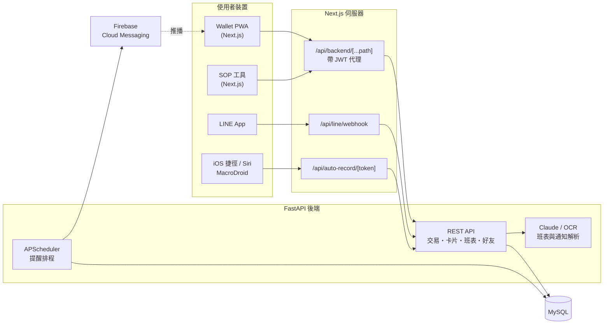

<div align="center">


# 易記帳 YiWallet

**會自己記帳的個人記帳 PWA：記帳、信用卡、班表薪資一次搞定**


</div>

---

## 📖 簡介

易記帳是一個可以安裝到手機主畫面的記帳 App。除了手動記帳，也能從 **LINE Bot、Apple Pay / LINE Pay 付款通知、Siri 語音、銀行通知截圖** 自動建立紀錄；同時管理信用卡帳單週期、打工班表與薪資，讓「這個月還能花多少」一眼就看得到。

這個 repo 是 pnpm monorepo，包含記帳主程式 `wallet` 與內部工具 `sop`；API 由另一個 FastAPI 後端提供。

## ✨ 功能特色

| 類別 | 功能 |
| --- | --- |
| 💰 記帳 | 收支記帳、自訂分類（名稱／圖示／顏色）、計算機輸入、常用備註快選、匯出 CSV |
| 🤖 自動記帳 | LINE Bot 傳訊息記帳、Apple Pay／LINE Pay 通知捷徑（iOS）、MacroDroid（Android）、語音與 Siri 記帳、銀行通知 OCR、電子發票匯入 |
| 💳 信用卡 | 結帳日／繳費日、本期消費與待繳金額、可用額度、帳單出爐與繳費提醒 |
| 📊 統計 | 週／月／年圖表、分類分析、現金流（發薪日 vs 卡費 vs 固定支出）、年度回顧 |
| 🗓️ 班表薪資 | 排班、多份工作時薪／月薪計算、假日加倍、班表 OCR 匯入、工作共享 |
| 👥 社交 | 好友、朋友分帳、推播通知 |
| 🔔 提醒 | 預算 80%／超支提醒、固定扣款前一天提醒、Firebase 推播 |
| 📱 PWA | 安裝到主畫面、離線提示頁、新版本自動提示更新 |

完整更新紀錄見 [`apps/wallet/lib/version.ts`](apps/wallet/lib/version.ts)。

## 🏗️ 系統架構



## 🧰 技術棧

| 層 | 技術 |
| --- | --- |
| 前端框架 | Next.js 16（App Router）、React 19、TypeScript |
| UI | Tailwind CSS 4、shadcn/ui、Radix UI、Base UI、lucide-react、vaul、cmdk |
| 圖表 | Recharts |
| 認證 | JWT（jose）+ Session Cookie、Google OAuth（arctic） |
| 推播 | Firebase Cloud Messaging |
| 後端 | FastAPI、SQLAlchemy、APScheduler、Anthropic SDK、LINE Bot SDK、firebase-admin |
| 資料庫 | MySQL |
| 部署 | Docker（Next.js standalone）+ docker compose |
| Monorepo | pnpm workspaces |

## 📂 專案結構

```text
YIWallet/
├── apps/
│   ├── wallet/              # 記帳主程式（Next.js PWA）
│   │   ├── app/
│   │   │   ├── (marketing)/   # 官網：功能介紹、FAQ、安裝教學
│   │   │   ├── (auth)/        # 登入、註冊、忘記密碼
│   │   │   ├── (wallet)/      # 首頁、交易、統計、班表、現金流、好友、設定…
│   │   │   └── api/           # 後端代理、LINE webhook、自動記帳、行事曆訂閱
│   │   ├── components/ contexts/ hooks/ lib/
│   │   └── proxy.ts           # 保護需登入的路由
│   └── sop/                 # 內部工具：條碼查詢、作業流程（port 3002）
├── packages/
│   ├── auth/                # @yiwallet/auth：共用登入邏輯
│   └── ui/                  # @yiwallet/ui：共用 UI 元件
├── deploy/                  # 正式機 docker compose 與後端 Dockerfile
├── docs/                    # 資料庫 schema（.sql / .dbschema）
└── Dockerfile               # 前端多階段建置
```

## 🚀 快速開始

需要 **Node.js 20+** 與 **pnpm**。

```bash
pnpm install

# 記帳主程式 → http://localhost:3000
pnpm --filter wallet dev

# SOP 工具 → http://localhost:3002
pnpm --filter sop dev
```

前端所有 API 都會經過 `/api/backend/[...path]` 轉給 `API_URL` 指向的 FastAPI 後端，本機開發時需要後端可連線。

> **本機測試 LINE Webhook**：LINE 需要公開 HTTPS，可以用 Cloudflare Tunnel：
> `npx cloudflared tunnel --url http://localhost:3000`，再把網址填到 LINE Developers 的 Webhook URL。

## ⚙️ 環境變數

放在 `apps/wallet/.env.local`：

| 變數 | 說明 |
| --- | --- |
| `API_URL` | FastAPI 後端網址 |
| `SESSION_SECRET` | 前端簽 session cookie 的密鑰（與後端 `JWT_SECRET` 是不同的鑰匙） |
| `NEXT_PUBLIC_BASE_URL` | 網站對外網址 |
| `NEXT_PUBLIC_WALLET_APP_URL` / `NEXT_PUBLIC_SOP_APP_URL` | 兩個 App 互相連結用 |
| `COOKIE_DOMAIN` | 兩個 App 共用登入時的 cookie 網域 |
| `GOOGLE_CLIENT_ID` / `GOOGLE_CLIENT_SECRET` | Google 登入 |
| `LINE_CHANNEL_SECRET` / `LINE_CHANNEL_ACCESS_TOKEN` | LINE Bot |
| `OCR_SPACE_API_KEY` | 班表 / 截圖 OCR |
| `NEXT_PUBLIC_FIREBASE_*` | Firebase 推播（API key、App ID、VAPID key…） |

> `NEXT_PUBLIC_*` 會在 build 時寫進 JS bundle，Docker 建置時要用 build arg 傳入。正式機完整清單見 [`deploy/prod.env.example`](deploy/prod.env.example)。

## 🚢 部署

正式機用 Docker Compose 一次起 MySQL、FastAPI 與 Next.js：

```bash
cd deploy
cp prod.env.example .env   # 填好所有密鑰
docker compose -f docker-compose.prod.yml up -d --build
```

詳細步驟（目錄配置、資料搬遷、外部服務網址更新）見 [`deploy/README.md`](deploy/README.md)。

### 發佈新版本

在 [`apps/wallet/lib/version.ts`](apps/wallet/lib/version.ts) 的 `VERSION_HISTORY` 最上面加一筆後 push，使用者就會看到「新版本可用」提示。

## 📚 相關文件

- [`deploy/README.md`](deploy/README.md) — 正式機部署
- [`docs/schema.sql`](docs/schema.sql) / [`docs/schema.dbschema`](docs/schema.dbschema) — 資料庫結構
